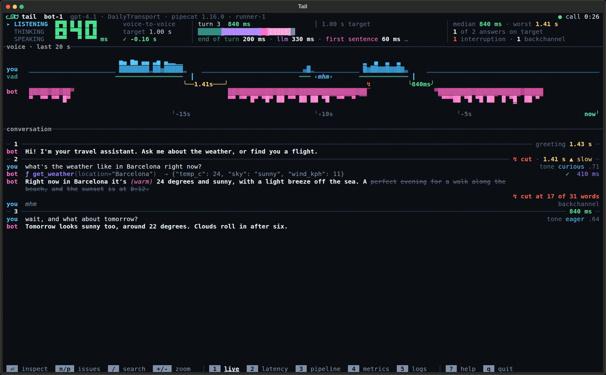

<h1><div align="center">
 
</div></h1>

[](https://pypi.org/project/pipecat-ai-tail) [](https://discord.gg/pipecat)

# ᓚᘏᗢ Tail: a terminal for voice agents

When you talk to your voice bot, it's hard to tell what happened. Did it cut you off? Was that silence the LLM, a tool call or the speech synthesis? What did the LLM actually get?

**Tail** is a terminal dashboard for bots built with [Pipecat](https://github.com/pipecat-ai/pipecat). While you talk to your bot, it shows:

- ⏱️ How long the bot takes to answer, counting up while it thinks, and where the time goes: end of turn, LLM, tools, speech.
- 💬 Every turn: what you said, the tool calls and the bot's words, so you see where an interruption cut the bot off.
- ⚠️ Early ends of turn, cut-offs, slow answers and errors, flagged on the turn they happened in.
- 🔍 The context the LLM saw for each turn, every processor in the pipeline, service metrics and logs.

<p align="center"></p>

## 🚀 Try it

```bash
uv tool install "pipecat-ai[cli]" --with pipecat-ai-tail
pipecat tail --demo
```

The demo plays a scripted call, so you can look around before [adding Tail to your bot](#-add-tail-to-your-bot).

## 📦 Install

Add Tail to your bot's project:

```bash
uv add pipecat-ai-tail
```

To watch from another terminal, also install the `pipecat tail` command (keep both on the same version):

```bash
uv tool install "pipecat-ai[cli]" --with pipecat-ai-tail
```

## 🔌 Add Tail to your bot

### Pipecat 1.3 and later

Add a `TailWorker` next to your bot's worker:

```python
from pipecat_tail import TailWorker

runner = WorkerRunner()
await runner.add_workers(worker, TailWorker(worker))
await runner.run()
```

The dashboard opens right in the bot's terminal, and quitting it stops the bot. To watch from another terminal instead, use `TailWorker(worker, server=True)` and run `pipecat tail` there. Without a terminal (in a container, say), Tail does that on its own.

### Pipecat 1.0 to 1.2

Add a `TailObserver` to your pipeline task, and run `pipecat tail` in another terminal:

```python
from pipecat_tail import TailObserver

task = PipelineTask(pipeline, observers=[TailObserver()])
```

### Without changing your bot

Write a Pipecat setup file that calls `setup_tail`:

```python
# tail_setup.py
from pipecat_tail import setup_tail

async def setup_pipeline_worker(worker):
    await setup_tail(worker)

async def setup_pipeline_task(task):  # Pipecat 1.0 to 1.2
    await setup_tail(task)

async def setup_worker_runner(runner):  # Pipecat 1.3+ warns when a setup file has none
    pass
```

Then run your bot with it:

```bash
PIPECAT_SETUP_FILES=tail_setup.py python bot.py
```

From Pipecat 1.8 the dashboard opens in the bot's terminal, as with a `TailWorker`. Before 1.8, run `pipecat tail` in another terminal.

## 🖥️ The dashboard

The top of the screen always shows the bot's state (**LISTENING**, **THINKING** or **SPEAKING**), the response clock, and, on wide terminals, the session's numbers. Below it are five views:

| View | What it shows |
| --- | --- |
| **1 Live** | Both voices on a timeline over the conversation |
| **2 Latency** | Where each answer's time went |
| **3 Pipeline** | The processors and their frames, startup, workers, jobs and the bus |
| **4 Metrics** | Each service's timings, tokens and usage |
| **5 Logs** | The bot's logs, with search and errors |

Response times are green under your target, amber up to 1.6 times it, and red above it, with ✓, ▲ and ✕ too. The target is 1 s; `pipecat tail --target 0.8` sets another.

Press Enter on a turn to see where its time went, the context the LLM saw, and the events behind it.

**Early ends of turn** (`▲ early end`) are turns Pipecat ended at a pause while you kept talking. Tail flags them and explains each one, so you know when to tune the VAD's `stop_secs` or your turn analyzer.

## ⌨️ Keys

| Key | What it does |
| --- | --- |
| `1`–`5` | Switch view |
| `↑` `↓` `⏎` | Select a turn and inspect it (Live, Latency) |
| `n` `p` | Next or previous issue (Live) or error (Logs) |
| `/` `esc` | Search, and end the search (Live, Logs) |
| `f` | Follow the call, or pause (Live, Logs) |
| `+` `-` | Zoom the voice timeline (Live) |
| `l` `b` | Cycle the log level (Logs), the bus filter (Pipeline) |
| `e` `x` | Show the latest error, dismiss the error line |
| `s` | Save a report |
| `w` `t` | Switch worker, theme |
| `c` | Reconnect |
| `?` | Help |
| `q` | Quit |
| `tab` `←` `→` `y` | In a turn: next page, other turns, copy as JSON |

## 💾 Reports and CI

`s` saves the session as Markdown and JSON in the current directory, to read or attach to an issue. `pipecat tail --report session.md` writes one when you quit.

For scripts and CI, `--json` prints the session as JSON lines, without the UI:

```bash
pipecat tail --json | jq 'select(.event == "turn") | {turn, latency_secs, grade}'
```

## 🌐 A bot on another machine

Tail listens on `localhost` only, since it carries everything said in the call. Tunnel to it:

```bash
ssh -L 9292:localhost:9292 bot-host
pipecat tail
```

`pipecat tail` reconnects on its own when the bot restarts (`c` retries right away), and catches up with a call already going.

## 📊 Metrics

The time each service takes needs metrics on in the pipeline:

```python
PipelineWorker(pipeline, params=PipelineParams(enable_metrics=True, enable_usage_metrics=True))
```

Without them, Tail still shows the response time, the conversation and the logs.

## 🧩 Pipecat versions

Tail works with every Pipecat 1.x release, and newer ones show more:

| Pipecat | What it adds |
| --- | --- |
| 1.0 | The conversation, audio levels, raw VAD, early ends of turn, latency breakdowns, startup, metrics, tool calls, errors, frame flow and logs |
| 1.3 | Workers, jobs and the bus (`TailWorker`) |
| 1.9 | Richer metrics, tool calls and errors, and latency breakdowns by contribution |
| 1.11 | The LLM's turn-completion markers |
| 1.13 | Typed messages, backchannels, and the raw LLM and TTS text |
| 1.15 | The bot's delivery tags and the user's tone |
| 1.16 | Diarized speakers |

## 🛠️ Contributing

```bash
uv sync --group dev
uv run pytest
```

`examples/bot.py` is a voice bot with Tail attached. It needs Deepgram, OpenAI and Cartesia keys in the environment or a `.env` file:

```bash
uv run --group examples examples/bot.py                      # the dashboard in this terminal
TAIL_RUNNER=observer uv run --group examples examples/bot.py   # then `pipecat tail` in another
```

Changes go in [towncrier](https://towncrier.readthedocs.io/) fragments in `changelog/`. For a release, the "Generate Changelog for Release" action builds `CHANGELOG.md` from them.

## 📚 Next steps

- [Pipecat](https://github.com/pipecat-ai/pipecat)
- [Whisker](https://github.com/pipecat-ai/whisker), a browser-based frame debugger for Pipecat
- Join the [Discord](https://discord.gg/pipecat)
