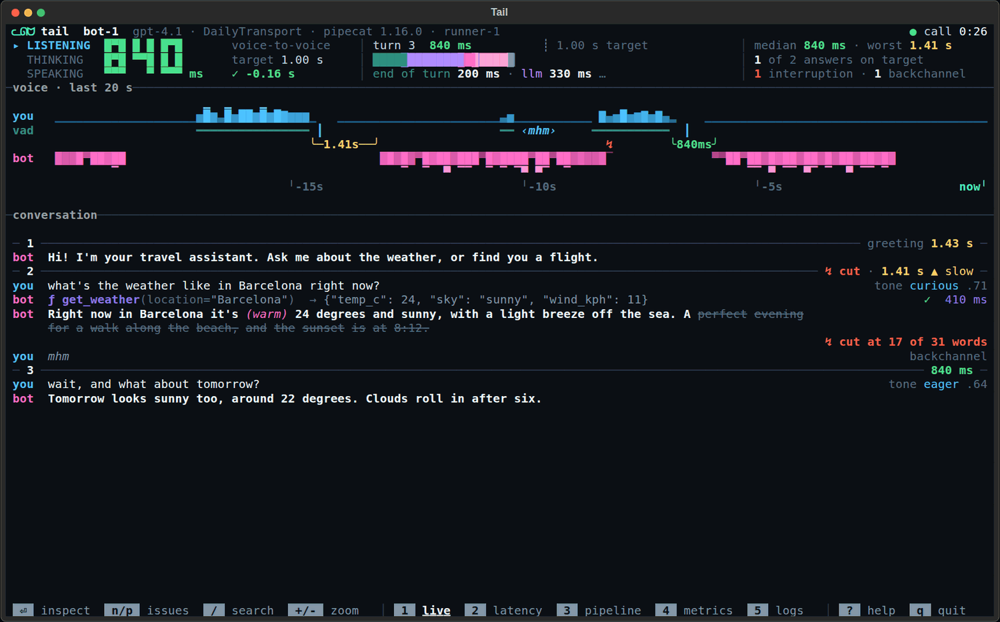

<h1><div align="center">
 
</div></h1>

[](https://pypi.org/project/pipecat-ai-tail) [](https://discord.gg/pipecat)

# ᓚᘏᗢ Tail: a terminal for voice agents

**Tail** is a terminal dashboard for bots built with [Pipecat](https://github.com/pipecat-ai/pipecat), the open source framework for voice and multimodal conversational AI.

It sits next to your bot while you talk to it. You hear the bot through its client; Tail shows what you can't hear: when the bot decided you had finished, how long each answer took and where that time went, what it transcribed, what the LLM saw and which tools it called, what it meant to say when you cut it off, and every processor in the pipeline with what flows through it. It fits a side pane as narrow as 48 columns as well as a full screen.

<p align="center"></p>

## What you see

The top of the screen is always there:

- **LISTENING**, **THINKING** or **SPEAKING**: what the bot is doing, the current state lit in its color.
- The **voice-to-voice** time in large digits, from you going silent to the bot speaking. It counts up while the bot thinks, then stays in its grade's color: green under your target, amber, or red.
- Where the current turn's time is going as it happens (end of turn, LLM, tools, first sentence, speech synthesis), replaced by Pipecat's measured breakdown once the bot speaks.
- On wide terminals, the session so far: median and worst response, how many answers were on target, early ends of turn, interruptions and errors.
- When a processor reports an error, a red line with the processor and the message, until `x` dismisses it (`e` finds it in the logs).

The status line says whether a call is on (`● call 2:31`), ended, or the bot is gone and Tail is reconnecting. The key line lists the keys of the current view and the five views, the current one underlined:

| View | What it shows |
| --- | --- |
| **1 Live** | The voice timeline: your audio and the bot's as two scrolling tracks, with raw VAD, the end of each turn, a bracket with each response time, backchannels and interruptions between them. Under it, the conversation, following the latest turn. Every turn is opened by a rule with its number, what went wrong (`▲ early end`, `↯ cut`) and how long the answer took: what you said or typed, with tone and speaker when the STT reads them and a thumbnail of any image sent to the LLM; tool calls with arguments, results and duration; the bot's words bright where spoken and dim where not yet, with delivery tags such as `(warm)`; backchannels; where an interruption cut the bot off; and what the LLM got of a turn that ended early. |
| **2 Latency** | A waterfall per turn from you going silent to the bot speaking, split into end of turn, transcription, LLM, tools, first sentence, speech synthesis and audio out; where the time goes per stage with p50, p95 and share; the distribution of turns; and speech lanes that put raw VAD next to the turn ruling for tuning `stop_secs` or smart-turn. |
| **3 Pipeline** | The processors and the frames moving through them, processor startup timing, the runner's workers, jobs and the bus. |
| **4 Metrics** | Each service's measurements as rows (time to first byte, to the first answer token, to the first audio, total processing): the last, a sparkline of recent measurements, the median and the worst, with what Pipecat notes about them, such as time spent thinking. Then usage: tokens in and out with the cache hit rate, TTS characters and STT audio. |
| **5 Logs** | Structured log records with a level filter, regex search and pinned errors. |

Press Enter on any turn to open the **turn inspector**, three pages that end at the raw data (`tab` moves between them, `←` `→` between turns, `y` copies the turn as JSON):

- **turn**: what was said, where the time went, tool calls pretty-printed, delivery and the turn-completion marker; for an early end, what Pipecat heard and how soon you went on.
- **context**: what the LLM saw for this turn, with what's new since the last turn marked: the system instruction, the tools offered with their parameters, and every message, tool calls and results included, images as thumbnails.
- **events**: every message Tail received for the turn, in order, timed from when you started speaking.

Keys: `1`–`5` switch views, `↑` `↓` select a turn, `⏎` inspects it, `n` `p` jump to the next or previous issue, `/` searches what was said in Live and the logs in Logs, `esc` ends a search, `f` follows or pauses, `+` `-` zoom the voice timeline, `l` cycles the log level, `b` cycles the bus filter, `e` jumps to the next error, `x` dismisses the error banner, `s` saves a report, `w` switches worker, `t` switches theme, `c` reconnects, `?` shows help, `q` quits. Help opens on what each mark on the screen means.

**Looking back.** Live follows the latest turn like a page: the text stays put while it fills the panel, and when it reaches the bottom the panel jumps so the latest line is in the middle, as Emacs recenters, so you read down instead of watching lines crawl up. `n` jumps to the next turn where something went wrong (an early end, a cut, a slow answer, a turn the LLM marked incomplete, an error) and `p` to the previous one, with the panel's title saying which of how many; `/` searches what you and the bot said and the tool calls, and `n` `p` then step through the matches. While you look back, and once the call is over, the voice timeline keeps only its lanes so the conversation has the room. The key line then shows `f follow` in amber: `f` follows the latest turn again.

**Early end of turn.** When you pause mid-sentence, Pipecat may decide you've finished: the LLM starts on what it heard, and when you go on, what you say next reaches it as another message. Tail flags such turns `▲ early end`, marks them on the voice timeline, counts them, and explains them in the turn inspector with how soon you went on. They're the signal for tuning the VAD's `stop_secs` or your turn analyzer.

Latency is green under the target, amber up to 1.6 times it and red above, with ✓, ▲ and ✕ next to the big digits so it never relies on color alone. The target is 1 s; set yours with `pipecat tail --target 0.8`.

To see it without a bot:

```bash
pipecat tail --demo
```

## Getting started

### Requirements

- Python 3.11+
- Pipecat 1.0+ (see [Pipecat versions](#pipecat-versions))

### Install

```bash
uv pip install pipecat-ai-tail
```

The standalone app is a `pipecat` CLI command. The CLI ships with Pipecat's `cli` extra:

```bash
uv tool install "pipecat-ai[cli]" --with pipecat-ai-tail
```

### Option A: attach without touching the bot

Pipecat loads setup files listed in `PIPECAT_SETUP_FILES`. Tail ships one, so this is the whole integration:

```bash
PIPECAT_SETUP_FILES=$(pipecat tail setup-file) python bot.py
```

then, in another terminal:

```bash
pipecat tail
```

Every pipeline worker the bot runs gets a Tail observer, and a Tail server worker joins the runner so workers, jobs and bus traffic show up too. With Pipecat 1.0 to 1.2, which run pipelines as a `PipelineTask`, each task gets a Tail observer. Set `TAIL_HOST` and `TAIL_PORT` to change where the server listens (default `localhost:9292`).

### Option B: observer in code

Add `TailObserver` to your pipeline worker (a `PipelineTask` before Pipecat 1.3). It serves its own websocket:

```python
from pipecat_tail import TailObserver

worker = PipelineWorker(pipeline, observers=[TailObserver()])
```

To also see workers, jobs and the bus (Pipecat 1.3+), add a `TailServer` to the runner and let it create the observer:

```python
from pipecat_tail import TailServer

tail = TailServer()
runner = WorkerRunner()
await runner.add_workers(worker, tail)
worker.add_observer(tail.create_observer(worker))
await runner.run()
```

### Option C: runner with the app built in

`TailRunner` is a `WorkerRunner` (Pipecat 1.3+) that opens the dashboard in the same terminal, no separate command needed:

```python
from pipecat_tail import TailRunner

runner = TailRunner()
await runner.add_workers(worker)
await runner.run()
```

While the dashboard is open the bot's output is kept off the terminal (output to a file is untouched). Quitting it with `q` stops the bot, and the bot's own log shows it shutting down. When the bot finishes first, the dashboard stays open until you quit.

## Pipecat versions

Tail works with every Pipecat 1.x release. It looks for what the bot's Pipecat has rather than checking version numbers, and reads the same information from RTVI where a newer observer is missing, so older bots see most of Tail:

| Pipecat | What Tail adds |
| --- | --- |
| 1.0 | Conversation, audio levels, raw VAD, speaking state, early ends of turn, latency breakdowns, turns, startup timing, metrics, tool calls, errors, frame flow, logs |
| 1.3 | Workers, jobs and the bus (`TailServer`, `TailRunner`) |
| 1.9 | Richer metrics, tool call and error reports from Pipecat's dedicated observers; latency breakdowns by contribution |
| 1.11 | The LLM's turn-completion markers |
| 1.13 | `user-input`: typed messages, backchannels, interim transcriptions; the raw STT, LLM and TTS text |
| 1.15 | The bot's delivery tags and the user's tone |
| 1.16 | Diarized speakers |

Tail stops forwarding the RTVI messages Pipecat 1.13 deprecated as soon as their replacements exist, so it keeps working when 2.0 removes them.

## Keeping a session

`s` saves the session in the current directory as `tail-report-<time>.md`, to read or paste into an issue, and `.json`, with every turn (what was said, latency by stage, tool calls, interruptions, early ends) and the session's percentiles, stage breakdown, usage and errors. `pipecat tail --report session.md` writes one when you quit.

For scripts and CI, `--json` runs without the UI and prints the session as JSON lines: a `turn` event as each turn ends, `error` events, and a `session_finished` summary. It exits when the bot goes away:

```bash
pipecat tail --json | jq 'select(.event == "turn") | {turn, latency_secs, grade}'
```

## A bot on another machine

Tail listens on `localhost` only, and the messages it sends include everything said in the call, so don't open the port to the network. Tunnel it instead:

```bash
ssh -L 9292:localhost:9292 bot-host
pipecat tail
```

## Reconnecting

The standalone app reconnects on its own with backoff when the bot restarts. Press `c` to retry immediately.

## Metrics

The time spent in each stage (LLM, TTS, STT) and service metrics need metrics enabled on the pipeline. The setup file (option A) turns them on when the bot left them off, and says so in the log; set `TAIL_ENABLE_METRICS=0` to keep them off. In code:

```python
PipelineWorker(pipeline, params=PipelineParams(enable_metrics=True, enable_usage_metrics=True))
```

Without them Tail still shows the total response time, the conversation, the voice timeline, workers and logs.

## Contributing

```bash
uv sync --group dev
uv run pytest
```

`examples/bot.py` is a voice bot with Tail attached (Deepgram, OpenAI and Cartesia keys in the environment or a `.env` file):

```bash
uv run --group examples examples/bot.py
```

Changes are recorded as [towncrier](https://towncrier.readthedocs.io/) fragments in `changelog/`.

## 📚 Next steps

- [Pipecat](https://github.com/pipecat-ai/pipecat)
- [Whisker](https://github.com/pipecat-ai/whisker), a browser-based frame debugger for Pipecat
- Join the [Discord](https://discord.gg/pipecat)
